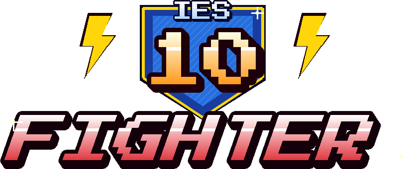

# IES 10 FIGHTER

Juego de lucha 2D estilo arcade de los 90, hecho en **Python + Pygame**, con los cuatro
luchadores del IES N.º 10: **PANTOJA, PARADA, NEHUEN y LUCIANO**, peleando en el aula.



---

## 1. Instalación (Windows)

1. Instalá **Python 3.10 o superior** desde <https://www.python.org/downloads/>
   (en el instalador marcá **“Add Python to PATH”**).
2. Descomprimí la carpeta `IES10_FIGHTER` donde quieras.
3. Abrí una terminal (*cmd* o *PowerShell*) dentro de esa carpeta e instalá la dependencia:

   ```
   pip install pygame-ce
   ```
   (si preferís el pygame clásico: `pip install pygame` — también funciona)

4. Ejecutá el juego:

   ```
   python main.py
   ```

Una vez instalado **no necesita internet**: todos los sprites, efectos, sonidos, voces y
músicas ya están dentro de `assets/`.

También funciona en Linux y macOS con los mismos pasos.

---

## 2. Controles

| Acción            | Jugador 1 | Jugador 2            |
|-------------------|-----------|----------------------|
| Moverse           | A / D     | ← / →                |
| Saltar            | W         | ↑                    |
| Agacharse         | S         | ↓                    |
| Puñetazo          | F         | 1 (o Num 1)          |
| Patada            | G         | 2 (o Num 2)          |
| Golpe especial    | R         | 3 (o Num 3)          |
| Ultimate          | T         | 4 (o Num 4)          |
| Bloquear          | E         | 5 (o Num 5)          |

**Combinaciones** (`→` = hacia el rival):

| Movimiento                 | Entrada                               |
|----------------------------|---------------------------------------|
| Golpe fuerte               | → + Puñetazo                          |
| Patada alta (fuerte)       | → + Patada                            |
| Jab bajo                   | ↓ + Puñetazo                          |
| Barrida (derriba)          | ↓ + Patada                            |
| Patada aérea               | Puñetazo o Patada en el aire          |
| Especial 1 / Especial 2    | Especial  /  ↓ + Especial             |
| Ultimate 1 / Ultimate 2    | Ultimate  /  ↓ + Ultimate (barra llena) |
| Bloqueo alto / bajo        | Bloquear  /  ↓ + Bloquear             |

- Las barridas sólo se bloquean **agachado**; las patadas aéreas sólo **de pie**.
- **ESC** o **P**: pausa (continuar, lista de movimientos, salir).
- **F11**: pantalla completa.
- Todos los controles se pueden cambiar en **OPCIONES → CONTROLES JUGADOR 1 / 2**.

---

## 3. Modos de juego

| Menú                          | Descripción |
|-------------------------------|-------------|
| **JUGAR → 1 JUGADOR VS CPU**  | Elegís tu luchador y el rival; combate rápido contra la computadora. |
| **JUGAR → ENTRENAMIENTO**     | Vida que se regenera y barra de ultimate infinita. **F1** cambia el comportamiento del rival (quieto / agachado / salta / bloquea todo / CPU), **F2** muestra las hitboxes, **F3** reinicia posiciones. |
| **MODO ARCADE**               | Enfrentás a los otros tres luchadores, con dificultad creciente y un **JEFE FINAL**. Hay pantalla de “¿Continuar?” y final propio para cada personaje. |
| **VERSUS**                    | Dos jugadores en el mismo teclado. |
| **PERSONAJES**                | Galería: todas las animaciones de cada luchador, estadísticas y lista de movimientos. |
| **OPCIONES**                  | Volumen de música / efectos / voces, tiempo por ronda (30/60/99/∞), rondas (1, mejor de 3, mejor de 5), dificultad de la CPU (Fácil/Normal/Difícil/Extremo), pantalla completa, filtro CRT, intro y controles. |

Cada combate es **al mejor de tres rondas** (configurable), con temporizador, KO, tiempo
agotado, empate, “¡Perfecto!”, contador de combos y pantalla **«PANTOJA WINS»**, etc.

---

## 4. Los luchadores

| | Fuerza | Velocidad | Resistencia | Alcance | Ejecución | Estilo |
|---|:-:|:-:|:-:|:-:|:-:|---|
| **PANTOJA** – *El tanque rosa* | 9 | 4 | 9 | 5 | 5 | Pesado, mucha vida, golpes demoledores |
| **PARADA** – *El rayo verde*   | 6 | 9 | 5 | 6 | 9 | Velocísimo, combos de impacto múltiple |
| **NEHUEN** – *El rockero del piluso* | 6 | 6 | 6 | 9 | 6 | Gran alcance, ataques aéreos y a distancia |
| **LUCIANO** – *El preceptor implacable* | 7 | 7 | 7 | 6 | 8 | Equilibrado, combos y remate brutal |

### Especiales y Ultimates (8 ultimates distintas)

| Personaje | Especial 1 | Especial 2 | Ultimate 1 | Ultimate 2 |
|---|---|---|---|---|
| Pantoja | **Panzazo** (embestida con la panza) | **Grito metalero** (onda sonora con cuernos) | **Terremoto Pantoja**: salto gigante y golpe al suelo que sacude toda el aula | **Lluvia de cachetadas**: 10 cachetadas + gancho final |
| Parada | **Ráfaga esmeralda** (dash con puño) | **Patada huracán** (doble patada ascendente) | **Mil piñas**: ráfaga supersónica de 14 puñetazos + empujón final | **Tornado verde**: cruces relámpago a través del rival + patada al cielo |
| Nehuen | **Acorde sónico** (proyectil de notas) | **Patada del piluso** (anti-aérea) | **Solo infinito**: rayo de notas musicales que atrapa al rival + explosión | **Meteoro piluso**: salto altísimo, voltereta y caída en picada explosiva |
| Luciano | **Credencial voladora** (boomerang) | **Gancho preceptor** (uppercut) | **Combo disciplinario**: combo de 6 golpes que termina en uppercut | **Amonestación final**: carga de poder y un único puñetazo devastador |

Cada ultimate tiene: animación de preparación, “super flash” con pantalla congelada,
recuadro cinematográfico con el retrato y el nombre del ataque, aura, animación de ataque,
efectos de impacto, reacción del rival, zoom y temblor de cámara, voz y sonido propios y
animación de finalización.

---

## 5. Estructura del proyecto

```
IES10_FIGHTER/
├── main.py                 ← ejecutar este archivo
├── config.py               ← resolución, rutas, controles, opciones (settings.json)
├── requirements.txt
├── game/
│   ├── player.py           ← luchador: estados, física, movimientos
│   ├── combat.py           ← rondas, daño, bloqueo, combos, proyectiles, ultimates, HUD
│   ├── characters_data.py  ← estadísticas, frases y TODOS los movimientos
│   ├── animations.py       ← reproducción de animaciones desde los spritesheets
│   ├── assets.py           ← carga/caché de spritesheets, efectos y fuentes
│   ├── collisions.py       ← hitboxes (círculo) vs hurtboxes (rectángulo por cuadro)
│   ├── controls.py         ← entrada con búfer
│   ├── ai.py               ← IA con 4 niveles de dificultad
│   ├── audio.py  particles.py  camera.py  stage.py  ui.py
├── screens/                ← intro, menú, selección, versus, combate, arcade,
│                             entrenamiento, opciones, galería, resultados
├── assets/
│   ├── characters/<nombre>/  ← spritesheets PNG + <nombre>_meta.json + retrato
│   ├── backgrounds/escenario.jpg
│   ├── effects/  sounds/  music/  interface/  fonts/
│   └── source/              ← ilustraciones originales de cada personaje
├── tools/                  ← generadores de sprites, efectos, audio y logo + test
└── documentation/
    ├── sprites_documentation.md
    ├── audio_credits.md
    └── capturas/           ← capturas de pantalla del juego
```

---

## 6. Cómo se hicieron los recursos (y qué tener en cuenta)

- **Sprites**: cada luchador se generó a partir de su ilustración original
  (`assets/source/*.jpg`). El script `tools/rig.py` separa la figura del fondo, la divide en
  partes (cabeza, torso, brazos, antebrazos, muslos, piernas y pies) y las vuelve a posar
  con cinemática directa e inversa para crear **cada cuadro** de **25 animaciones por
  personaje (≈ 230 cuadros cada uno)**, cuantizados a la paleta original para mantener el
  estilo pixel-art. Es una animación por recortes (*cut-out*), no dibujada a mano cuadro a
  cuadro: los rasgos, la ropa y los colores son exactamente los de la ilustración, pero en
  poses extremas pueden verse uniones algo duras en hombros o caderas.
- **Sonido y música**: el entorno donde se creó el juego no tenía acceso a Freesound,
  OpenGameArt, Pixabay ni Kenney, así que **todo el audio es original**, sintetizado por
  `tools/build_audio.py` (golpes, efectos, 6 temas chiptune) y las voces con el
  sintetizador libre **eSpeak NG** (suenan robóticas, al estilo de los locutores arcade).
  Si querés reemplazar cualquier sonido, poné un archivo `.ogg` o `.wav` con **el mismo
  nombre** en `assets/sounds/` o `assets/music/` (ver `documentation/audio_credits.md`).
- **Fuente**: *Press Start 2P* (SIL Open Font License).

### Regenerar recursos (opcional)

```
pip install -r requirements.txt
python tools/build_sprites.py     # spritesheets de los 4 personajes (~6 min)
python tools/build_effects.py     # efectos especiales
python tools/build_interface.py   # logo e ícono
python tools/build_audio.py       # efectos, voces y música
python tools/test_headless.py     # prueba automática + capturas
```
